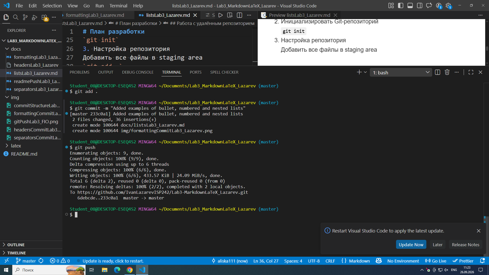

# лабораторная работа №3
Изучение работы с markdown. оформление .md файлов.

## содержание
- [ссылка на github](https://github.com/IvanLazarevISP242/Lab3-MarkdownLaTeX_Lazarev.git)

---
## форматирование текста
**полужирный**
*курсив*
~~зачеркнутый~~
моноширный
## списки
- маркированный 1
- маркированный 2
- маркированный 3
---
1. нумерованный 1
2. нумерованный 2
3. нумерованный 3
--- 
1. вложеный
    - подпункт 1
    - подпункт 2
---
## цитата
> цитата 1 уровня

## блок кода python
```python
print('hello world')
```
## таблица
| 1 | 2 | 3 |
| - | - | - |
| a | b | c |
| d | e | f |

## изображение


## ссылка
[внешняя](https://github.com/IvanLazarevISP242/Lab3-MarkdownLaTeX_Lazarev)


## чекбоксы
[] task 1
[x] task 2

## сноска 
сноска [^1]
[^1]: сноска 1

## alert-блоки
> [!NOTE] 
> совет
> [!TIP]
> важный совет
> [!WARNING]
> предупреждение

## inline latex
 $S = \pi r^2$
## block latex
$$
\sum_{i=1}^n i = \frac{n(n+1)}{2}
$$
